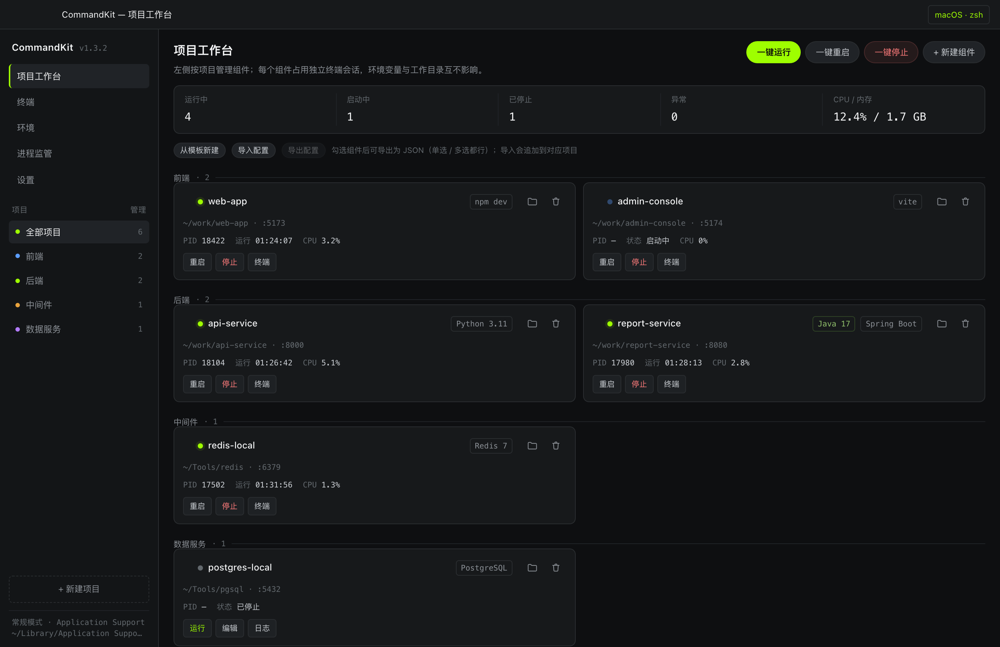
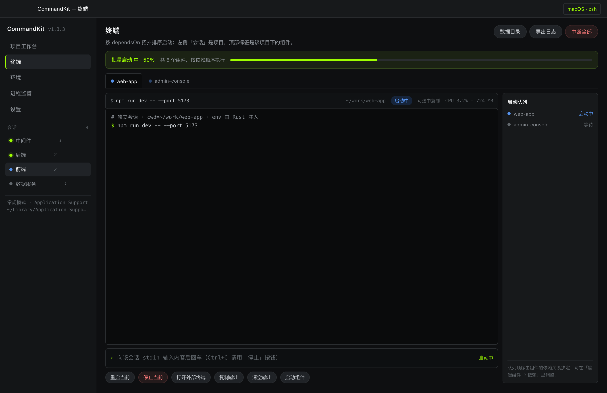
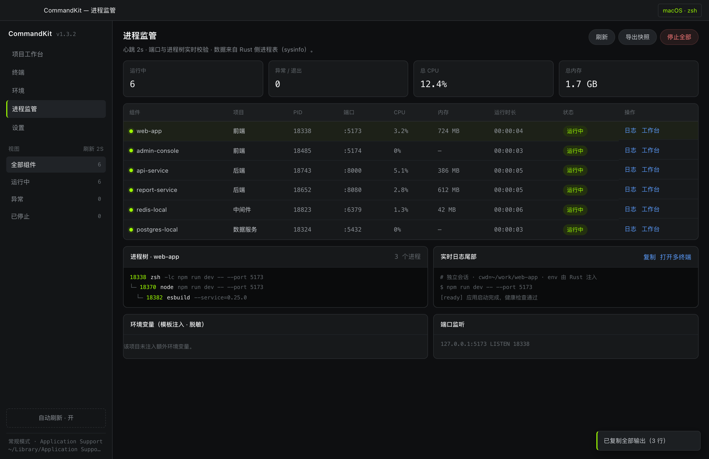
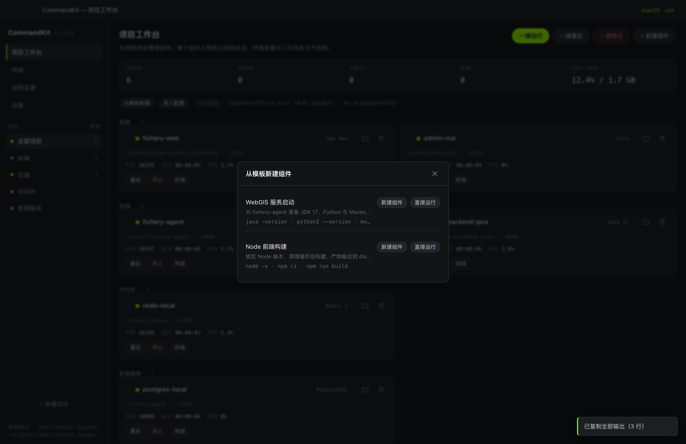

# CommandKit

[](https://github.com/RisoMi/CommandKit/actions/workflows/build.yml)

命令环境模板 + 多项目进程管理桌面应用。**项目（组件分组）→ 组件（启动单元）** 两级模型，
Tauri 2（Rust 进程监管 + Vue 3 前端），
Windows 便携版（exe 同目录 `data\`）+ macOS 常规版（`~/Library/Application Support/CommandKit/`）。

对应设计稿：`CommandKit · 命令环境模板管理`（Ardot fileId 746898820539136）
—— 07 项目工作台、08 批量运行、09 进程监管（模板库已并入项目工作台）。



---

## 0. 出包（GitHub Actions）

`.github/workflows/build.yml` 会在 **push 到 main / 打 `v*` tag / 手动 dispatch / PR** 时构建：

| Job | 内容 |
| --- | --- |
| `build (macos-universal)` | `cargo test` → universal `.app` → `CommandKit-macos-universal.zip` |
| `build (windows-x64)` | `cargo test` → `CommandKit-windows-x64.zip`（便携 exe + 说明 + `installer/` 内的 NSIS 安装程序） |
| `publish release` | 仅 tag 触发，把上面所有 zip / exe 挂到 GitHub Release |

- 任意一次 run 的产物在 Actions 页面的 **Artifacts** 可直接下载（保留 30 天）。
- 进程监管（`supervisor`）只依赖极小的 `EventSink` 抽象，不依赖 Tauri 运行时：
  生产用 `TauriSink(AppHandle)`，测试用 `NullSink`。这样 Windows 上测试二进制不会去链接
  wry / WebView2 —— 早前用 `tauri::test` 的 mock 运行时会在 Windows 报
  `0xC0000139 STATUS_ENTRYPOINT_NOT_FOUND`，导致 runtime 套件根本没跑（假绿）。
- 发布正式版本：`git tag v1.1.0 && git push origin v1.1.0`，等 workflow 完成后到 Releases 取包。

```bash
git tag v1.1.0
git push origin v1.1.0
```

## 1. 快速开始

```bash
npm install

npm run app:dev     # 开发模式（Vite :1420 + Tauri 窗口，热更新）
npm run app:build   # 发布构建
```

产物：

| 平台 | 产物 | 说明 |
| --- | --- | --- |
| macOS | `src-tauri/target/release/bundle/macos/CommandKit.app` | 常规安装版，数据在 `~/Library/Application Support/CommandKit/` |
| Windows | `src-tauri/target/release/CommandKit.exe` | **便携版**：前端资源已内嵌，复制到任意目录双击即用；首次启动在 exe 同级创建 `data\` |

> macOS 默认只产出 `.app`（`tauri.macos.conf.json` 里 `bundle.targets = ["app"]`）。
> 本机 macOS 27 上 Tauri 的 `create-dmg` 脚本与新版 `hdiutil` 不兼容（`grep: bad regex '/dev/diskN'`），
> 需要 dmg 时：`npm run app:build -- --bundles dmg`，或手动 `hdiutil create -volname CommandKit -srcfolder CommandKit.app out.dmg`。

> Windows 包必须在 Windows 上构建（Tauri 不支持交叉编译到 MSVC / WebView2）。
> Windows 10 缺 WebView2 时由 `downloadBootstrapper` 引导安装（见 `tauri.conf.json`）。
> 未签名 exe 会触发 SmartScreen「更多信息 → 仍要运行」。

### 已验证项（本机 macOS 实测）

```bash
cargo test --tests          # 13 个用例：拓扑排序 / 环境变量展开 / 进程树终止 / 原子写 + 备份 /
                            #            shell 参数形式（cmd /D /C、powershell -Command、posix -lc）
                            #           真起子 shell 抓 stdout+stderr / 非零退出→Failed /
                            #           健康检查门控 / stop 后整树死亡 / env 注入不影响宿主
node scripts/ci-test.mjs    # CI 里跑的那套（失败行会转成 check-run annotation）
node scripts/shots.mjs      # 用 Playwright 跑构建产物，输出 shots/01..08 截图（演示数据）
```

`dist/` 产物可直接在浏览器打开做视觉走查：`src/bridge.ts` 检测到没有 Tauri 运行时即切到
`src/mock.ts`（内存示例数据、不会启动真实进程）。Tauri 窗口内永远走真实 IPC。


---

## 2. 数据目录与持久化

| 平台 | 根目录 | 解析方式 |
| --- | --- | --- |
| Windows | `<exe 所在目录>\data\` | `std::env::current_exe()?.parent()` 拼接 `data`，**禁用 `app_data_dir()`** |
| macOS | `~/Library/Application Support/CommandKit/` | `$HOME/Library/Application Support/CommandKit` |

```
data\
  projects.json            项目 + 分类（唯一真相源）
  templates.json           模板（env / workdir / 命令序列）
  settings.json            默认 shell、日志行数、确认开关、刷新间隔
  process-snapshot.json    进程快照（「导出快照」时写入）
  logs\<id>.log            每个会话的终端输出（追加写，重启不清空）
  backup\*.json            每次覆盖前自动备份，保留最近 10 版
  exports\*.log            手动导出的日志
  .commandkit.lock         文件锁（fs2 排他锁，进程退出自动释放）
```

**可靠性策略**

- 原子写：`xxx.json.tmp` → `write + fsync` → `rename` 覆盖；覆盖前把旧文件复制进 `backup\`（按时间戳，保留 10 份）。
- 解析失败不阻塞启动：损坏文件重命名为 `*.corrupt` 后回退默认值。
- 单实例：`tauri-plugin-single-instance`（第二次启动唤起已有窗口）+ `data\.commandkit.lock` 排他文件锁（双保险，防并发写）。
- 目录可写预检：`Program Files` / 只读 U 盘 / 网络盘会在 UI 顶部给出「数据目录不可写」横幅。

---

## 3. 进程模型

### 3.1 独立子 shell

每个项目 / 模板各起一个子 shell，互不共享环境：

shell 家族决定参数形式（`supervisor::shell_invocation`，有单测覆盖）：

| 家族 | 调用形式 | 说明 |
| --- | --- | --- |
| CMD | `cmd.exe /D /C "<command>"` | `/D` 关掉 AutoRun，避免注册表启动脚本污染环境 |
| PowerShell 7 / Windows PowerShell | `<shell> -NoProfile -Command "<command>"` | 不加载 profile |
| POSIX（zsh / bash / sh） | `<shell> -lc "<command>"` | 登录 shell，确保 Finder 启动时也能拿到用户 PATH |

- **默认 shell**：设置 → 运行 → 默认 shell（下拉，Windows 给 pwsh / powershell / cmd，macOS 给 zsh / bash / sh，也可填自定义路径）。
- **组件级覆盖**：编辑组件 → 执行 shell，可选「跟随设置」或单独指定；模板同理。

### 3.2 命令链（且 / 或）

组件的启动命令是一个**有序步骤列表**，步骤之间用「且 / 或」连接（`CommandStep { cmd, join }`）：

| 连接 | 语义 |
| --- | --- |
| 且 | 上一条**成功**后继续；上一条失败则按失败策略处理（默认中止） |
| 或 | 上一条**失败**时才跑这一条（备选）；上一条成功则跳过 |

- 例：`npm ci` 且 `npm run dev` —— 装依赖成功才启动服务；
  `pnpm i` 且 `npm run dev` 或 `yarn dev` —— 前两条失败时改跑 `yarn dev`。
- 每一步在独立子 shell 里跑，输出进同一个会话（终端里以 `# 步骤 1/2` 分隔）。
- **健康检查挂在最后一条主线命令**（后面没有「且」步骤的那条）上，前面的构建步骤不触发健康检查。
- 整条链以最后一步的退出码收尾；任一步失败且没有「或」备选，会话即 `Failed`。

Windows 上 `pwsh.exe` 不存在时会自动回退 `powershell.exe` 并在终端里提示一行。

- `cwd` = 项目 `workdir`（支持 `~` 展开；目录不存在直接报错，不静默回退）。
- `stdio` 全 piped：stdout / stderr 分流读取，stdin 可写（终端底部输入行）。
- 环境变量：`Command::env(k, v)` 逐个注入，**从不调用 `setx` / 写注册表 / 改 `.zshrc`**；
  值支持 `%PATH%` / `$PATH` / `${VAR}` 引用（先展开项目内互相引用，再展开宿主环境）。
- Windows 下 `PATH` 键统一规整为 `Path`，避免大小写重复。

### 3.2 输出流转发

```
子进程 stdout/stderr → tokio read(8KB) → UTF-8 增量解码（跨块多字节不乱码）
  → 环形缓冲（≤512KB，供切换标签回放）
  → 追加写 data\logs\<id>.log
  → 事件 ck:term{ id, seq, data, stream }
  → 前端按 rAF 合批 → ANSI SGR 渲染（颜色 / 加粗 / 变暗 / 反色）
```

### 3.3 进程树终止

| 平台 | 实现 |
| --- | --- |
| Windows | `taskkill /PID <pid> /T /F`（递归整棵树；PID 不存在视为成功） |
| macOS | 子进程以 `process_group(0)` 启动（pgid == pid）→ `kill(-pid, SIGTERM)`，2s 后 `kill(-pid, SIGKILL)` 兜底 |

停止是「发信号 + 由 waiter 收敛状态」：`stopping = true` → `Stopping` → 进程真正退出后转 `Stopped`，
避免出现「按钮已置为停止但进程还在」的假状态。

### 3.4 健康检查

- 类型：TCP 端口探活，或本机 HTTP GET（自带极简客户端，只读状态行，不引 HTTP 依赖）。
- 参数：`timeoutMs` / `retry` / `intervalMs`；通过后才把状态从 `Starting` 提升为 `Running`。
- 超时：标记 `Failed` + 记录原因，并终止该会话进程树。
- 无常健康检查的项目：spawn 成功即 `Running`。

### 3.5 状态机

```
Stopped → Starting → Running → Stopping → Stopped
                  ↘ Restarting ↗
Running → Failed（非零退出 / 健康检查失败 / 启动失败）
```

`Starting` / `Stopping` / `Restarting` 期间拒绝重复触发同一操作；
`Failed` 保留退出码、错误原因与日志尾部。`restartOnCrash` 开启时按 `maxRestarts` 自动重启（1.2s 退避）。

### 3.6 批量编排

- `dependsOn` → Kahn 拓扑排序，同层按界面顺序保持稳定；检测到环直接报错（`依赖存在循环：a / b`）。
- 一键运行：正序启动，前序健康检查通过后再启动后继；`failFast` 决定前序失败时中止还是跳过继续。
- 一键停止 / 重启：逆序终止；重启 = 逆序停 → 正序启，需二次确认。
- 「中断全部」置取消位并停止队列中在跑的会话，未开始的标记 `已跳过`。
- 单条操作（卡片 / 表格行内）只影响自身会话，不触碰其它终端与会话缓冲。

---

## 4. 进程监管（09 屏）

- 指标：sysinfo 进程表每 `refreshMs`（默认 2s）刷新一次，按会话根 PID 聚合整棵进程树的 CPU / 内存 / 子进程数，经 `ck:metrics` 推给前端。
- 详情：进程树（PID / 名称 / 命令行）、环境变量（`SECRET|TOKEN|PASSWORD|KEY` 自动脱敏）、端口监听状态、日志尾部 14 行（可一键复制）。
- 终端输出可直接鼠标选中复制（⌘/Ctrl + C），也可点「复制输出」：有选中复制选中，无选中复制整段（已剥离 ANSI 转义）。
- 端口预检：启动前若端口已被占用，终端里先输出一条 `[preflight] 端口 xxxx 已被占用（PID …）`（macOS 用 `lsof`，Windows 用 `netstat -ano`），不阻断启动。

---

## 4.6 组件配置导入 / 导出

- **导出**：工作台勾选组件（单选或多选）→ 工具栏「导出配置 (N)」→ 选保存路径，得到
  `{ app, kind: "components", version: 1, exportedAt, components: [...] }`。
- **导入**：工具栏「导入配置」→ 选 JSON → 追加到对应项目。兼容三种形态：
  上面的导出文件、组件数组、单个组件对象。
- 导入冲突处理：id 已存在则重新分配（依赖关系跟着改写）、同项目重名加「(导入)」后缀、
  未知项目归到「未归属」、缺名称或缺命令的条目跳过并在结果里报告。
- 依赖 `tauri-plugin-dialog` 提供原生保存 / 打开对话框。

## 5. IPC 命令一览

| 命令 | 作用 |
| --- | --- |
| `bootstrap` | 返回全量快照（info / projects / categories / templates / settings / sessions / metrics / bulk） |
| `save_project` `delete_project` | **项目**（组件分组）增改删（删除时组件回到「未归属」） |
| `save_component` `delete_component` | **组件**增改删（返回新快照） |
| `save_template` `delete_template` | 模板增改删（模板在「项目工作台 → 从模板新建」里使用） |
| `export_components` `import_components` | 组件配置导出 / 导入（JSON，支持单选与多选） |
| `save_settings` | 设置保存（行数 300~20000 夹取，刷新 500~10000ms 夹取） |
| `run_component` `stop_component` `restart_component` | 单个组件操作 |
| `run_many` `stop_many_cmd` `restart_many` `cancel_bulk_cmd` | 批量操作（拓扑编排，进度走 `ck:bulk` 事件） |
| `run_template` | 以 `tpl:<id>` 为会话 id 运行模板 |
| `send_input_cmd` | 向会话 stdin 写入 |
| `session_log` `clear_session_log` | 会话缓冲回放 / 清空 |
| `process_detail` | 进程树 / env / 端口 / 日志尾部 |
| `export_log` `export_snapshot` | 导出到 `data\exports\` / `data\process-snapshot.json` |
| `open_data_dir` `open_workdir` `open_external_terminal` | 打开目录 / 外部终端 |

事件：`ck:session`（会话状态变更）、`ck:term`（终端输出）、`ck:metrics`（指标）、`ck:bulk`（批量进度）、`ck:health`、`ck:toast`。

前端只通过 IPC 调能力，`capabilities/default.json` 只放行窗口拖动 / 最小化 / 最大化 / 关闭，**没有** shell / fs 插件权限。

---

## 6. 窗口外壳

- 单层自定义标题栏（40px、`#17191B`、底部 1px `#2A2D30`、左右内边距 14px），与设计稿 01/05 对齐。
- macOS：`decorations: true` + `titleBarStyle: "Overlay"` + `hiddenTitle`，原生红黄绿灯左置（`trafficLightPosition 15,13`），保留原生缩放 / 圆角 / 阴影。
- Windows：`decorations: false`，自绘 `— ▢ ✕` 于右上，`data-tauri-drag-region` 提供拖动。
- 两端的平台配置拆分在 `src-tauri/tauri.macos.conf.json`（Tauri 平台配置自动合并）。

---

## 7. 快捷键

| 按键 | 作用 |
| --- | --- |
| `⌘/Ctrl + 1..4` | 切换 项目工作台 / 终端 / 进程监管 / 设置 |
| `Esc` | 关闭弹层 / 取消确认 |

---

## 8. 目录结构

```
commandkit/
  src/                      Vue 3 前端
    views/                  Workbench(07) · BulkRun(08) · Monitor(09) · Templates · SettingsView
    components/             TitleBar · SideNav · ProjectCard · Terminal · ProjectDialog · ConfirmDialog
    store.ts                全局状态 + 事件订阅 + 终端缓冲（rAF 合批 + 3000 行环形裁剪）
    ansi.ts                 ANSI SGR → 渲染片段
    api.ts / types.ts       IPC 封装与类型（与 Rust serde camelCase 对齐）
  src-tauri/src/
    lib.rs                  启动、单实例、状态装配、命令注册
    state.rs                数据存储 / 会话表 / 批量态 / 首启种子数据
    store.rs                数据目录解析 · 原子写 · 备份 · 文件锁 · 本地时间
    model.rs                项目 / 分类 / 模板 / 设置 / 状态机模型
    supervisor.rs           子 shell 启动、输出转发、健康检查、终止、拓扑排序、批量编排
    proc.rs                 进程树终止 / 端口占用 / 外部终端
    metrics.rs              sysinfo 指标聚合与进程详情
    commands.rs             IPC 命令
  scripts/make-icon.mjs     图标源图生成（纯 Node，无依赖）
```

---

## 9. 已知限制

1. **不是完整 PTY**：子进程 stdio 走管道，`vim` / `htop` 这类全屏 TUI 无法正常渲染；逐行交互（`redis-cli`、`python` REPL 单行）可用。需要完整 PTY 时应引入 `portable-pty`（代价是各平台再加一层原生依赖）。
2. **健康检查只支持本机**：TCP 端口 / `http://` 本机端点；不解析 https、不跟随重定向。
3. **CPU 为单核百分比**：sysinfo 口径，`100%` = 占满一个核心。
4. **跨平台构建**：Windows 产物需在 Windows 机器上 `npm run app:build`。
5. **Windows 便携版**不写注册表 / AppData / 开始菜单；放到 `Program Files` 会因无写权限触发只读警告——这是刻意的设计约束，不是缺陷。
6. 项目 `command` 按单行命令处理（多命令用 `&&` 或 `;` 串联），UI 未提供多行脚本编辑。

---

## 10. 界面

| 07 项目工作台 | 08 批量运行 · 多终端 |
| --- | --- |
|  |  |

| 09 进程监管 | 从模板新建组件 |
| --- | --- |
|  |  |

截图由 `node scripts/shots.mjs` 跑构建产物自动生成（演示数据，不启动真实进程）。
